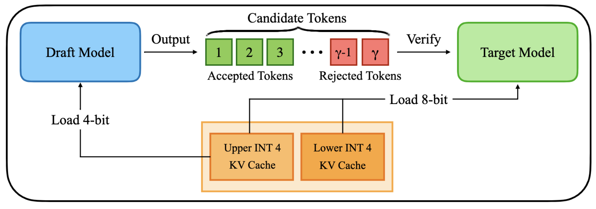

# QuantSpec: Self-Speculative Decoding with Hierarchical Quantized KV Cache

[[Paper]](https://arxiv.org/abs/2502.10424)

This repository contains the code for **QuantSpec**, a framework for accelerating long-context LLM inference on edge devices by combining self-speculative decoding with a hierarchical quantized KV cache.

<p align="center">
  
</p>

## Key Idea

The KV cache is the primary bottleneck in both GPU memory usage and latency during LLM inference. QuantSpec addresses this with:

1. **Hierarchical Quantized KV Cache**: A two-level (upper/lower bit) quantization scheme that compresses the KV cache to 4-bit, drastically reducing memory footprint and attention latency.
2. **Self-Speculative Decoding**: The same model serves as both the draft and target — the draft uses the quantized KV cache (fast but approximate), while the target verifies using full-precision residual tokens. No separate draft model needed.
3. **Optional Weight Quantization**: 4-bit Marlin/GPTQ weight quantization for the draft model's MLP layers, further accelerating draft token generation.

QuantSpec achieves **>90% acceptance rates**, **~2.5x end-to-end speedup**, and **~1.3x memory reduction** compared to methods using sparse KV caches.

## Supported Models

- LLaMA-2 (7B, 13B, 70B)
- LLaMA-2-7B-32K / 32K-Instruct
- LLaMA-3 (8B, 70B)
- LLaMA-3.1-8B / 8B-Instruct
- LWM-Text-128K / Chat-128K
- Qwen2.5-7B / 7B-Instruct
- Mistral-7B-v0.3

## Installation

```bash
conda create -n quantspec python=3.11
conda activate quantspec
pip install torch --index-url https://download.pytorch.org/whl/cu121
conda install -c conda-forge gxx=13.2.0
pip install -r requirements.txt
pip install flash-attn --no-build-isolation
pip install -e marlin/
```

**Requirements**: CUDA 12.1, GCC 13.2, PyTorch 2.4.0

## Usage

### 1. Download and Convert Model

```bash
# Download model weights from HuggingFace
bash tests/download_and_prepare.sh meta-llama/Llama-2-7b-hf --hf_token <your_token>
```

This downloads the model and converts it to the format used by QuantSpec (a single `model.pth` file).

### 2. (Optional) Prepare Marlin Weight Quantization

For weight-quantized draft acceleration, you need GPTQ-quantized weights converted to Marlin format. See the [Marlin](https://github.com/IST-DASLab/marlin) and [GPTQ](https://github.com/AutoGPTQ/AutoGPTQ) repositories for instructions.

### 3. Run QuantSpec Benchmark

```bash
# Basic run (single GPU)
bash tests/run.sh 0

# With torch.compile and weight quantization
bash tests/run_compile.sh

# Autoregressive baseline for comparison
bash tests/run_compile_baseline.sh 0 4000
```

### 4. Direct Python Usage

```bash
# QuantSpec speculative decoding
CUDA_VISIBLE_DEVICES=0 torchrun --standalone --nproc_per_node=1 \
    tests/quantspec_benchmark.py \
    --model checkpoints/meta-llama/Llama-2-7b-hf/model.pth \
    --model_name meta-llama/Llama-2-7b-hf \
    --gamma 6 \
    --B 1 \
    --prefix_len 4000 \
    --gen_len 64 \
    --dataset pg19 \
    --rank_group 0 \
    --benchmark \
    --compile

# With 4-bit weight quantization for draft model
CUDA_VISIBLE_DEVICES=0 torchrun --standalone --nproc_per_node=1 \
    tests/quantspec_benchmark.py \
    --model checkpoints/meta-llama/Llama-2-7b-hf/model.pth \
    --model_name meta-llama/Llama-2-7b-hf \
    --marlin_path marlin/gptq/checkpoint.pt.marlin.g128 \
    --gamma 6 \
    --B 1 \
    --prefix_len 4000 \
    --gen_len 64 \
    --dataset pg19 \
    --rank_group 0 \
    --wq \
    --benchmark \
    --compile
```

### Key Arguments

| Argument | Description | Default |
|---|---|---|
| `--model` | Path to converted model checkpoint (`.pth`) | - |
| `--model_name` | HuggingFace model name (for tokenizer) | - |
| `--marlin_path` | Path to Marlin-quantized weights (optional) | None |
| `--gamma` | Number of speculative draft tokens | 5 |
| `--B` | Batch size | 1 |
| `--prefix_len` | Input prompt length | 4000 |
| `--gen_len` | Number of tokens to generate | 64 |
| `--dataset` | Dataset: `pg19`, `multilexsum`, `infbench` | pg19 |
| `--wq` | Enable 4-bit weight quantization for draft | False |
| `--compile` | Enable `torch.compile` | False |

### Multi-GPU (Tensor Parallel)

```bash
# 2-GPU tensor parallel
CUDA_VISIBLE_DEVICES=0,1 torchrun --standalone --nproc_per_node=2 \
    tests/quantspec_benchmark.py \
    --model checkpoints/meta-llama/Llama-2-70b/model.pth \
    --model_name meta-llama/Llama-2-70b-hf \
    --rank_group 0 1 \
    --gamma 6 --B 1 --prefix_len 4000 --gen_len 64 \
    --benchmark --compile
```

## Project Structure

```
QuantSpec/
├── Engine/
│   ├── model.py                 # Base Transformer (FP16 KV cache)
│   ├── model_quantspec.py       # QuantSpec Transformer (quantized KV + optional weight quant)
│   ├── backend.py               # Inference backend (baseline autoregressive)
│   ├── backend_quantspec.py     # Inference backend (speculative decoding)
│   ├── utils.py                 # Model loading, sampling, custom torch.library ops
│   └── tp.py                    # Tensor parallelism
├── kernels/
│   ├── flashdecoding/           # Triton flash decoding kernels
│   │   ├── fp16/                # Standard FP16 attention
│   │   ├── int8_upperlower/     # Draft: quantized KV attention (hierarchical)
│   │   ├── int8_verify_upperlower/  # Target: multi-token verification attention
│   │   ├── int4_int8pack/       # INT4 KV with INT8 packing
│   │   ├── int4_int32pack/      # INT4 KV with INT32 packing
│   │   └── int8_int8pack/       # INT8 KV with INT8 packing
│   └── quantize/                # Triton quantization + packing kernels
├── Data/
│   ├── data_converter.py        # Dataset loading (PG-19, MultiLexSum, InfiniteBench)
│   └── pg19/                    # PG-19 dataset files
├── tests/
│   ├── quantspec_benchmark.py   # Main QuantSpec benchmark
│   ├── baseline_benchmark.py    # Autoregressive baseline benchmark
│   └── *.sh                     # Run scripts
├── marlin/                      # Marlin CUDA kernels (git submodule)
├── convert_hf_checkpoint.py     # Convert HF checkpoints to QuantSpec format
├── download.py                  # Download models from HuggingFace
└── requirements.txt
```

## Citation

```bibtex
@article{tiwari2025quantspec,
  title={QuantSpec: Self-Speculative Decoding with Hierarchical Quantized KV Cache},
  author={Tiwari, Rishabh and Xi, Haocheng and Tomar, Aditya and Hooper, Coleman and Kim, Sehoon and Horton, Maxwell and Najibi, Mahyar and Mahoney, Michael W. and Keutzer, Kurt and Gholami, Amir},
  journal={arXiv preprint arXiv:2502.10424},
  year={2025}
}
```

## Acknowledgments

This codebase builds on [gpt-fast](https://github.com/pytorch-labs/gpt-fast) for the model architecture and [Marlin](https://github.com/IST-DASLab/marlin) for 4-bit weight quantization kernels.
